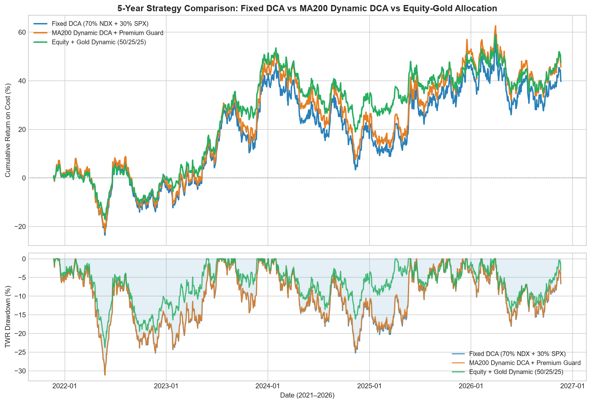
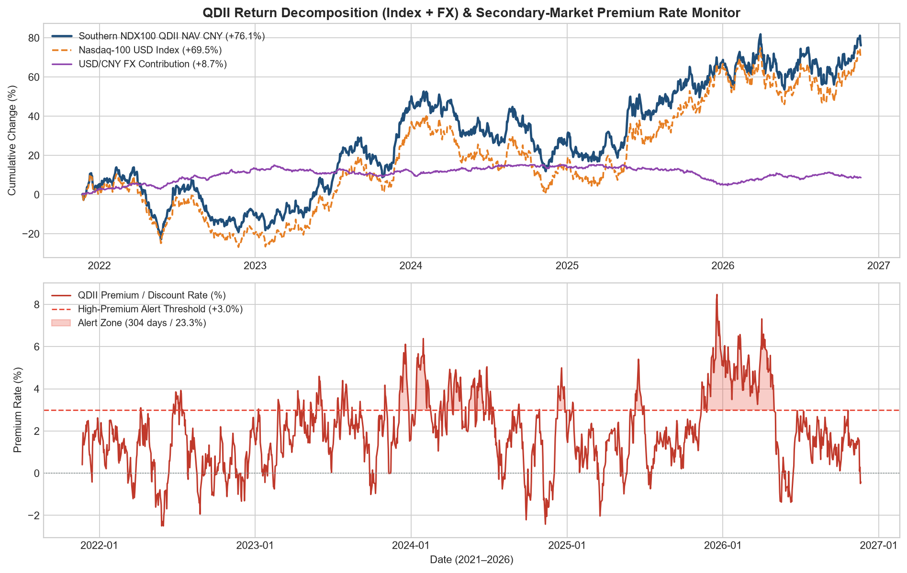
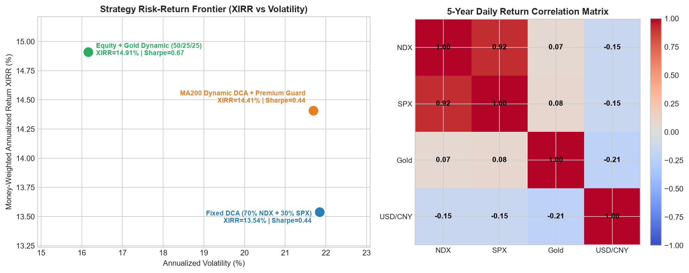

# 个人权益指数资产配置与 QDII 量化定投回测分析

> **Equity Index Asset Allocation, QDII Attribution & Dynamic DCA Quant Backtest**  
> 跟踪 **纳斯达克 100（NDX）**、**标普 500（SPX）**、**黄金（Gold）** 与代表性 **QDII 基金（如南方纳斯达克 100 QDII）**，构建净值-汇率-溢价率三因子归因模型，并实证对比 **定期定额**、**均线偏离动态定投（含高溢价分流）** 与 **股金动态配置组合** 的 5 年量化绩效。


---

## 一、项目核心功能

1. **QDII 净值三因子归因与溢价率监控（`src/qdii_tracker.py`）**
   - 拆解人民币计价 QDII 基金净值收益为：**底层指数贡献（NDX USD）+ 汇率贡献（USD/CNY）+ 费率与跟踪误差残差**。
   - 追踪场内/场外折溢价率，自动触发高溢价预警（`Premium > +3.0%`），量化额度收紧期间追高溢价对长期收益的侵蚀。
2. **多策略 5 年定投量化回测引擎（`src/backtest_engine.py`）**
   - **Fixed DCA（定期定额）**：双周定额买入 70% NDX QDII + 30% SPX。
   - **MA200 Dynamic DCA + Premium Guard（均线偏离动态定投）**：依据标的相对 200 日均线的偏离度动态调整每期扣款倍数（`0.5x ~ 2.0x`），并在 QDII 溢价率高于 `+3.5%` 时自动将 50% 纳指增量分流至低溢价标普 500。
   - **Equity + Gold Dynamic（50% NDX + 25% SPX + 25% 黄金）**：引入与美股低相关性的黄金资产，检验跨资产风险分散效果。
   - 完整输出 **资金加权年化收益率（XIRR）**、时间加权年化收益（TWR CAGR）、年化波动率、夏普比率、索提诺比率、最大回撤与卡玛比率。

---

## 二、5 年实证绩效对比（2021–2026）

| 策略名称 | 累计投入 (RMB) | 期末市值 (RMB) | 成本收益率 | XIRR (年化) | 年化波动率 | 夏普比率 | 索提诺比率 | 最大回撤 | 卡玛比率 |
| :--- | :---: | :---: | :---: | :---: | :---: | :---: | :---: | :---: | :---: |
| Fixed DCA (70% NDX + 30% SPX) | 262,000 | 366,087 | +39.73% | **13.54%** | 21.84% | 0.44 | 0.73 | -31.11% | 0.37 |
| MA200 Dynamic DCA + Premium Guard | 241,466 | 351,638 | +45.63% | **14.41%** | 21.69% | 0.44 | 0.74 | -31.11% | 0.37 |
| **Equity + Gold Dynamic (50/25/25)** | **241,466** | **356,236** | **+47.53%** | **14.91%** | **16.16%** | **0.67** | **1.12** | **-23.76%** | **0.54** |

### 关键实证发现
- **QDII 收益归因**：近 5 年南方纳斯达克 100 QDII 净值累计涨幅 `+76.08%`，其中底层 NDX 指数涨幅 `+69.47%`（贡献 `93.2%`），USD/CNY 汇率升值 `+8.65%`（贡献 `+14.7%`），管理费与跟踪误差合计拖累 `-7.9%`；高溢价预警（`> +3.0%`）覆盖 `304` 个交易日（占比 `23.3%`）。
- **均线偏离动态定投优势**：在更少的累计投入资金下，将资金加权年化收益率（XIRR）由 `13.54%` 提升至 `14.41%`（+87 bps），成本收益率提升近 `5.9` 个百分点。
- **股金多资产配置效应**：配置 `25%` 黄金后，组合年化波动率由 `21.84%` 降至 `16.16%`，最大回撤由 `-31.11%` 大幅收敛至 `-23.76%`，夏普比率由 `0.44` 跃升至 `0.67`。

---

## 三、可视化回测图表







---

## 四、目录结构与运行指南

```text
index-qdii-quant-backtest/
├── requirements.txt
├── src/
│   ├── qdii_tracker.py             # 5 年市场与 QDII 数据管线（支持 --live 对接 yfinance）及三因子归因
│   ├── backtest_engine.py          # Fixed DCA / 均线偏离动态定投 / 股金配置回测与 XIRR 求解
│   └── visualize.py                # 一键运行全流程并生成高清图表与回测报告
├── data/                           # 5 年对齐日频行情与 QDII 溢价率数据
├── reports/                        # 自动生成的 Markdown 实证分析报告与 JSON 指标
└── assets/                         # 回测净值、QDII 归因与相关性热力图
```

```bash
pip install -r requirements.txt
python -m src.visualize

# 可选：尝试通过 yfinance 拉取最新 5 年在线行情
# python -m src.qdii_tracker --live
```
